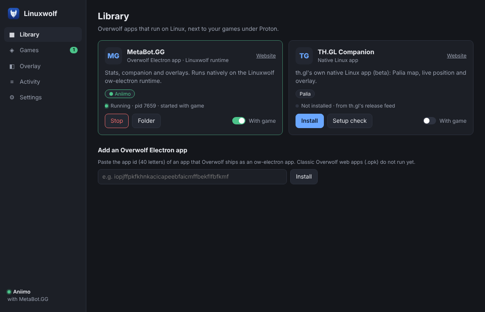

# Linuxwolf

A native Linux runtime for Overwolf apps, built to work with games running
under Steam Proton.

Overwolf itself does not run on Linux, not even with Wine workarounds.
Linuxwolf takes the other route: the apps run natively on Linux, and
Linuxwolf provides the pieces Overwolf normally provides (game detection,
game events, in-game overlay, app distribution).

**Status:** early prototype (step 2 of the [roadmap](ROADMAP.md)): MetaBot runs natively on Linux and reacts to Aniimo, tested headless. First
target: [MetaBot.GG](https://metabot.gg/) with
[Aniimo](https://store.steampowered.com/app/4126040) under Proton on
KDE Plasma (Wayland).

## Desktop app

```sh
gui/bin/linuxwolf                    # first start downloads Electron, needs Node.js >= 22.12
gui/bin/linuxwolf --install-desktop  # add it to the app menu
```

Install, start and stop apps, see your Steam games and which ones run under
Proton, start apps together with their game, manage the overlay layer and
check your setup. See [docs/gui.md](docs/gui.md).



## What is here

| Path | What it does |
|---|---|
| `gui` | The desktop app (Electron): library, games, auto-start with games, overlay, activity log, settings. Wraps the scripts below and the ow-electron runtime. |
| `crates/lw-detect` | Detects games running under Proton/Wine by scanning `/proc` (Steam app id, game exe, Wine prefix). `cargo run -p lw-detect -- --watch` |
| `crates/lw-overlay-layer` | Vulkan layer that draws an overlay into a game's frames. Works for Proton games because DXVK/VKD3D present through Vulkan. Currently draws a test HUD. |
| `crates/lw-vk-smoketest` | Headless Vulkan app that checks the layer really draws into presented images (runs on Mesa lavapipe, no GPU needed). |
| `runtime/ow-electron` | Runs ow-electron apps (Overwolf's Electron fork, e.g. MetaBot) on stock Linux Electron: `app.overwolf`, `reg.exe`/Steam emulation, Windows-only module shims, KDE window handling. See [docs/step-2.md](docs/step-2.md). |
| `tools/` | `fetch-thgl-companion.sh` + `thgl-palia-check.sh` (th.gl's native Linux app for Palia, see [docs/palia.md](docs/palia.md)), `fetch-ow-electron-app.sh` (installs an ow-electron app from Overwolf's feed), `metabot-smoketest.sh`, `smoketest.sh`, `install-overlay.sh`, font generator. |
| `docs/` | Spike reports and design notes. |

## Try it from the terminal

```sh
# Game detection: start a Proton game, then
cargo run -p lw-detect

# Overlay test HUD in a Proton game
tools/install-overlay.sh
# Steam > game > Properties > Launch options:
#   LINUXWOLF_OVERLAY=1 %command%

# MetaBot on Linux (needs node/npm and 7z)
(cd runtime/ow-electron && npm install)
tools/fetch-ow-electron-app.sh iopjffpkfkhnkacicapeebfaicmffbekflfbfkmf
runtime/ow-electron/bin/linuxwolf-run ~/.local/share/linuxwolf/apps/iopjffpkfkhnkacicapeebfaicmffbekflfbfkmf/4.0.4

# th.gl Palia map/overlay (th.gl's own native Linux app, Palia via Steam/Proton)
tools/fetch-thgl-companion.sh
tools/thgl-palia-check.sh
~/.local/share/linuxwolf/apps/thgl-companion/THGL_Companion-x86_64.AppImage

# Headless overlay test (needs a Vulkan driver, e.g. mesa-vulkan-drivers)
tools/smoketest.sh
```

Read [docs/spike-1.md](docs/spike-1.md) before using the overlay with games
that ship kernel-level anti-cheat.

## License

Not chosen yet.
