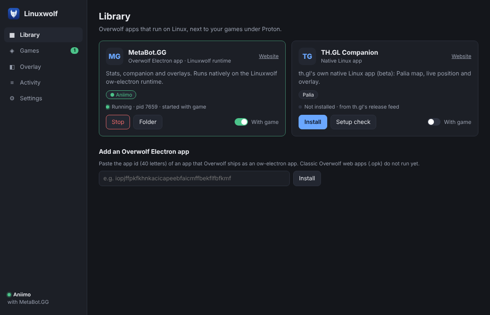
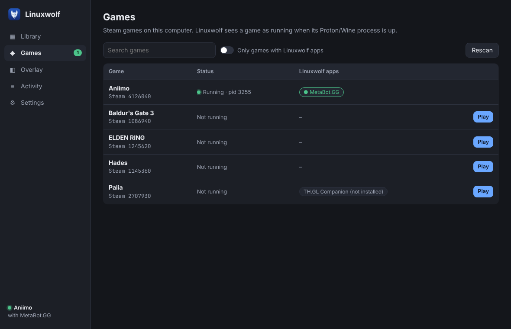

# Linuxwolf desktop app

Date: 2026-11-21 · Electron 42.11.4 (the same binary the ow-electron runtime uses)

The desktop app puts the scripts and the runtime behind one window, so
nothing needs a terminal after the first start.



## Start it

```sh
gui/bin/linuxwolf                      # first start installs Electron (needs Node.js >= 22.12)
gui/bin/linuxwolf --install-desktop    # add "Linuxwolf" to the KDE app menu
gui/bin/linuxwolf --install-autostart  # start in the tray at login (for auto-start with games)
```

`linuxwolf --hidden` starts straight into the tray. The window itself runs
natively on Wayland; `LINUXWOLF_GUI_OZONE=x11` forces XWayland.

## What it does

| Page | What you get | Built on |
|---|---|---|
| Library | MetaBot.GG, the TH.GL Companion and WoW Forever Map with Install / Update / Start / Stop / Remove, a setup check for TH.GL, a "With game" switch per app, and a field to install any other Overwolf app by its app id (classic `.opk` or ow-electron). | `tools/fetch-ow-electron-app.sh`, `tools/fetch-opk-app.sh`, `tools/fetch-overwolf-app.sh`, `tools/fetch-thgl-companion.sh`, `tools/thgl-palia-check.sh`, `runtime/ow-electron/bin/linuxwolf-run` |
| Games | Installed Steam games (all libraries, native and Flatpak Steam), which ones run under Proton right now, which Linuxwolf apps go with them, and a Play button (`steam://rungameid/<id>`). Other Wine/Proton processes are listed too. | `runtime/ow-electron/src/steam.js` and `proc.js` (same rules as `lw-detect`) |
| Overlay | Build/install/remove the Vulkan overlay layer, copy the Steam launch option, anti-cheat note. | `tools/install-overlay.sh` |
| Activity | Live output of every install, check and running app, with Stop and "Open log file". | logs in `~/.local/state/linuxwolf/gui/` |
| Settings | XWayland vs. Wayland for ow-electron apps, KDE on-screen-display mode, stop apps when their game exits, close to tray, debug log; plus a check of this computer (session, XWayland, Steam, glibc, ptrace_scope, FUSE, needed tools). | `LINUXWOLF_BACKEND`, `LINUXWOLF_OSD`, `LINUXWOLF_DEBUG`; settings in `~/.config/linuxwolf/gui.json` |

### Auto-start with games

With "With game" on, Linuxwolf starts the app as soon as one of its games
shows up as a Proton process (checked every 3 s), and shows a desktop
notification. Optionally it stops the app again when the game exits. This
only works while Linuxwolf runs, so "close to tray" is on by default, and
`--install-autostart` makes it start at login.

### Apps outlive the window

Apps write their output into their log file, not into a pipe to the GUI,
and run in their own process group. Quitting Linuxwolf leaves them
running; on the next start Linuxwolf finds them again (by `--lw-app=` on the
Electron command line, or `APPIMAGE=` for the TH.GL AppImage) and can stop
them. Stop sends SIGTERM to the whole process group, SIGKILL after 5 s.

## Code

`gui/` has no build step and no npm dependencies of its own: plain HTML/CSS
and JS in `src/ui/`, a sandboxed renderer that talks to the main process only
through `src/preload.js`. The logic sits in `src/core/` and is plain Node, so
it is tested without Electron:

```sh
cd gui && npm test
```

| File | |
|---|---|
| `src/main.js` | window, tray, IPC, game watcher and auto-start |
| `src/core/catalog.js` | known apps, installed apps, install and start commands |
| `src/core/games.js` | Steam games, running Proton games, known non-Steam Wine games (WoW Forever), start/stop events |
| `src/core/processes.js` | starting/stopping apps and scripts, log following, finding running apps |
| `src/core/system.js` | system check and overlay layer state |
| `src/core/settings.js` | settings file |

`runtime/ow-electron/bin/lw-electron` (new) finds or installs the Electron
binary; `linuxwolf-run` and the GUI share it.

## Tested

In the cloud (Xvfb, no GPU, fake Steam library, a fake Aniimo-under-Proton
process), driven through the real window with Playwright:

- Install MetaBot from Overwolf's feed through the Library (4.0.5 at the
  time), progress in Activity.
- "With game" on, start the fake Aniimo: MetaBot starts by itself, the
  Library and Games pages show both as running.
- Quit Linuxwolf: MetaBot keeps running. Start Linuxwolf again: it shows
  MetaBot as running and stops it.
- TH.GL setup check runs and shows its output.

Not tested yet: a real KDE Plasma session (tray, notifications, Wayland
window), the Play button with a real Steam client, the overlay build from
the GUI.


