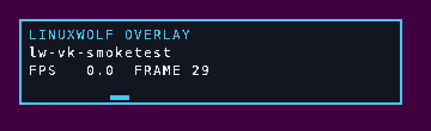

# Spike 1: Feasibility

Date: 2026-11-16

Questions:

1. Can Linuxwolf reliably tell that a game is running under Proton?
2. Can Linuxwolf draw into a Proton game without touching its Windows side?
3. What does the first target app, MetaBot.GG, actually need from Overwolf?

## 1. Game detection under Proton

`crates/lw-detect` scans `/proc`. A Proton game is a Linux process whose
environment holds the Steam app id (`SteamAppId`, `SteamGameId` or
`STEAM_COMPAT_APP_ID`) and whose command line names a Windows `.exe`.
Steam, Wine and Proton helper processes (`steam.exe`, `services.exe`,
`winedevice.exe`, ...) share that environment and are filtered by name.
Plain Wine games are detected through `WINEPREFIX` or the
`wine*-preloader` binary.

- Aniimo is Steam app **4126040**
  ([store page](https://store.steampowered.com/app/4126040)).
- `lw-detect --watch` prints `game_started` / `game_stopped` JSON lines,
  which is the "is the game running" signal Metabot needs (see 3).
- Tested with unit tests against a fake `/proc`. **Not yet tested with
  a real Aniimo process.**

## 2. In-game overlay via a Vulkan layer

Under Proton, DXVK (D3D9-11) and VKD3D-Proton (D3D12) translate DirectX
to Vulkan, so every frame of a Proton game is presented through
`vkQueuePresentKHR` on the Linux side. `crates/lw-overlay-layer` is a
Vulkan layer (`VK_LAYER_LINUXWOLF_overlay`) that hooks that call:

- adds `TRANSFER_DST` to the swapchain usage in `vkCreateSwapchainKHR`,
- before each present, copies a HUD bitmap into a rectangle of the image
  (`vkCmdCopyBufferToImage`) on the presenting queue, chained between the
  game's semaphores and the present,
- leaves 10-bit/HDR swapchains alone for now.

This needs no DLL injection, no DirectX hooks and no compositor support,
which matters on Wayland, where a client cannot force a window above a
fullscreen game. MangoHud works the same way. The layer is opt-in per game
with the launch option `LINUXWOLF_OVERLAY=1 %command%`.

Verified with `tools/smoketest.sh`: a headless Vulkan app renders 30
frames on Mesa lavapipe with the Khronos validation layer on. The HUD was
found in all 29 checked presented images, with no validation errors.

In step 2+ the bitmap comes from the app renderer instead of the test
HUD; a blend pass replaces the plain copy for transparency.

**Not yet tested in a real game.** Open checks on a real machine:

- the layer loads inside Steam's pressure-vessel container (MangoHud does
  this with the same user-level manifest location),
- Aniimo uses a B8G8R8A8/R8G8B8A8 swapchain,
- the anti-cheat accepts it. The Steam page says Aniimo "uses kernel level
  anti-cheat". If it runs under Proton, that is the Linux-compatible mode
  of its anti-cheat, and Vulkan layers like MangoHud are usually fine
  there, but there is no guarantee. Test on a throwaway account first.

## 3. What Metabot needs

Full analysis: `metabot-analysis.md` in the project files. Summary:

- Metabot 4.0.4 is an **ow-electron** app: Electron 42 with Overwolf's
  fork, a normal `app.asar`, no `manifest.json` and no `overwolf.*` API
  in its web pages. Overwolf features live in the main process under
  `app.overwolf.packages` (`gep`, `overlay`, `recorder`, `utility`, `ads`),
  and each feature turns itself off cleanly if its package is missing.
- **For Aniimo, Metabot uses neither game events (GEP) nor overlay
  injection.** It detects the game through the Steam registry flag
  `HKCU\Software\Valve\Steam\Apps\4126040\Running` (via `reg.exe`), and
  shows a transparent, click-through, always-on-top Electron window.
- Windows-only parts it hits for Aniimo: `reg.exe`, `koffi` calls into
  `user32`/`kernel32`, and `process.platform !== "win32"` guards.
- Metabot is downloaded from Overwolf's Electron update feed as a
  regular `setup.exe`; the app can be unpacked without running it.

### Two ways to run Metabot

**A. Windows build inside the game's Proton prefix** (e.g. with
`protontricks-launch --appid 4126040`). No patching, `reg.exe` and the
FFI calls run in Wine. Quickest to try, but not native Linux, and an
always-on-top Wine window may not stay above the game on KWin.

**B. Native: Metabot's `app.asar` on Linux Electron 42** with a
Linuxwolf runtime that provides `app.overwolf` and shims `reg.exe`,
`koffi` and the platform checks. `reg.exe ... Running` is answered from
`lw-detect`. This is the actual Linuxwolf product direction.

## Consequences for the plan

- The Vulkan layer is **not needed for Metabot + Aniimo**. It stays as
  the overlay path for games where apps need in-game overlays (LoL, TFT,
  Valorant, ...) and as a fallback if a window cannot stay above a
  fullscreen game on KWin.
- Step 2 becomes an **ow-electron runtime** first; the classic `.opk` +
  `overwolf.*` shim moves later.
- Step 3 needs only "Aniimo running / not running", which `lw-detect`
  already provides.

See [ROADMAP.md](../ROADMAP.md).
